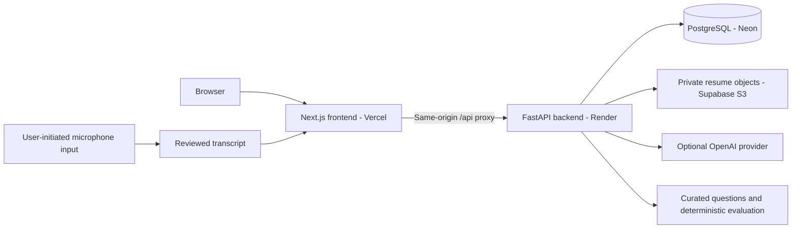

# InterviewAI

**Practice smarter. Interview better.**

A full-stack technical interview preparation platform with resume-aware practice, voice or text answers, structured feedback, and progress analytics.

## [Open the live InterviewAI demo](https://ai-interview-platform-one-mu.vercel.app)

[](https://github.com/keshav1234567891011/ai-interview-platform/actions/workflows/ci.yml)

[Features](#features) | [Architecture](#architecture) | [Local development](#local-development) | [Testing](#testing) | [Documentation](#documentation)

The portfolio demo is hosted on Vercel with a FastAPI backend on Render, PostgreSQL on Neon, and private resume storage on Supabase. Free backend hosting may take longer to respond after inactivity. No paid AI credential is needed to use the deterministic interview and evaluation fallback.

## Features

| Area | Capabilities |
| --- | --- |
| Candidate workspace | Secure registration and login, editable profiles, target roles, experience levels, and normalized technical skills |
| Resume and job analysis | Private PDF/DOCX uploads, text parsing, deterministic skill extraction, job-description analysis, matched/missing skills, and baseline match percentage |
| Mock interviews | Role, difficulty, focus-area and question-count selection; curated questions; persisted answers and recoverable sessions |
| Optional AI assistance | Context-aware question generation, adaptive difficulty, validated structured output, and automatic fallback on missing credentials or provider failures |
| Voice or text answers | Deliberate microphone activation, recording controls, playback, reviewed transcripts, and an always-available text workflow |
| Evaluation and feedback | Technical, reasoning and communication scores; missed concepts; question-level feedback; topic recommendations; descriptive pace and filler signals |
| Scheduling and progress | Timezone-aware scheduling, rescheduling/cancellation, interview history, real score trends, topic breakdowns, and analytics empty states |
| Interview experience | Responsive dark/light interface, optional procedural 3D interviewer, browser question read-aloud, and static/text fallbacks |
| Owner and administration | Single-owner control center, delegated admin permissions, account management, audit events, and owner-only encrypted AI settings |

Authenticated dashboards use stored user data. Landing-page product previews are labeled demonstrations, not real user statistics.

### Try the candidate workflow

1. Open the [live demo](https://ai-interview-platform-one-mu.vercel.app) and create a candidate account.
2. Complete your profile; optionally upload a resume and compare its skills with a job description.
3. Choose an interview role, difficulty, focus areas, and question count.
4. Answer with text or opt into microphone input where supported.
5. Review results, revisit interview history, and plan your next practice session.

Owner and admin access use the same authentication system with backend-enforced authorization. Privileged accounts and credentials are not published as demo logins.

## Architecture



Browser API requests go through the Next.js proxy. Database, object-storage, JWT, encryption, and AI credentials remain server-side. Neon uses pooled runtime connections and a separate direct connection for controlled migrations. Supabase is used for private object storage; application accounts and records remain in PostgreSQL on Neon.

### Technology stack

| Layer | Technologies |
| --- | --- |
| Frontend | Next.js App Router, React, TypeScript, Tailwind CSS, Geist, Lucide React |
| Visualization | Recharts, lazy-loaded Three.js, browser speech and recording APIs |
| Backend | Python, FastAPI, Pydantic, SQLAlchemy 2.x, Alembic |
| Persistence | PostgreSQL, Neon, private S3-compatible Supabase Storage |
| Security | Argon2 password hashing, validated JWT cookies, session revocation, role/permission checks, Fernet credential encryption |
| Quality and operations | pytest, Ruff, Playwright, Axe, Docker, GitHub Actions |

### Repository structure

```text
frontend/       Pages, shared components, design system, browser tests
backend/        API, schemas, models, services, migrations, backend tests
config/         Shared local development address configuration
scripts/        Development launcher and guarded acceptance-test helpers
docs/           Architecture, security, deployment, and implementation guides
.github/        CI workflows for frontend, backend, and container validation
render.yaml     Render backend Blueprint
```

## Local development

### Prerequisites

- Node.js 24 and npm
- Python 3.14
- A separately running PostgreSQL instance

The commands below use PowerShell. Keep dependency installations and generated files inside the repository.

### Install dependencies

From the repository root:

```powershell
npm --prefix frontend ci
python -m venv --copies backend/.venv
backend/.venv/Scripts/python.exe -m pip install -r backend/requirements-dev.txt
```

### Configure the backend

Create an ignored `backend/.env` using [backend/.env.example](backend/.env.example) as the format. Supply private local values; do not copy production credentials into development.

| Setting | Purpose |
| --- | --- |
| `DATABASE_URL` | PostgreSQL connection using the `postgresql+psycopg` driver; URL-encode special characters in credentials |
| `JWT_SECRET` | Independent cryptographically random signing secret of at least 32 bytes |
| `SETTINGS_ENCRYPTION_KEY` | Valid Fernet key, required for owner-managed encrypted AI credentials; keep stable and privately backed up |
| `OPENAI_API_KEY` | Optional environment fallback; omit for deterministic operation |
| `FRONTEND_ORIGINS` | Explicit permitted frontend origins; local defaults are configured by the application |

Local resume storage is the default. Production uses the existing S3 adapter with explicit bucket, region, endpoint, and server-only credentials. See [storage and deployment configuration](docs/production-launch.md). Frontend hosting configuration is documented in [frontend/.env.example](frontend/.env.example); `BACKEND_API_URL` is server-only and is resolved before the frontend build.

Apply the migration chain to your configured local database:

```powershell
backend/.venv/Scripts/python.exe -m alembic -c backend/alembic.ini upgrade head
```

### Start both services

From the repository root:

```powershell
npm run dev
```

| Service | Local URL |
| --- | --- |
| Frontend | http://localhost:3000 |
| Backend | http://127.0.0.1:8010 |
| FastAPI documentation | http://127.0.0.1:8010/docs |
| Liveness | http://127.0.0.1:8010/health |
| Database, migration and JWT readiness | http://127.0.0.1:8010/ready |

The root command starts the frontend and backend with source reload. PostgreSQL runs separately, normally on port 5432. Development addresses are centralized in `config/development.json`. See the [local development guide](docs/local-development.md) for launcher behavior and troubleshooting.

## AI, voice, and privacy

- **Optional AI:** candidate-opted-in sessions can use profile, resume, job-description, and recent-answer context. Structured outputs are validated before use. Missing keys, invalid responses, duplicates, timeouts, and provider errors fall back safely.
- **Owner AI settings:** `/owner/ai-settings` supports encrypted credential replacement/removal, supported model selection, provider enable/disable, and explicit connection testing. An enabled provider prefers a usable encrypted database credential, then the environment credential. Explicit disable blocks both sources.
- **Microphone control:** recording starts only after deliberate user action. Recording state is visible, media tracks stop when finished or the page is left, and text input remains available. Raw audio is not permanently retained by the application; submitted transcripts and feedback are persisted.
- **Session security:** HttpOnly JWT cookies, Secure cookies in production, expiry/issuer/audience checks, active-account and session-version validation, logout revocation, explicit-origin write protection, and shared database rate limits.
- **Authorization:** public registration creates a normal user. Admin permissions are checked on the backend for each request. Only the owner manages delegated admins and AI credentials; safe responses do not expose saved credentials, hashes, or session tokens.

For a **fresh installation only**, the [owner bootstrap procedure](docs/owner-control-center.md) uses private temporary credentials and enforces a first-login password change. Never rerun bootstrap to replace an existing owner or change a deployed owner's password.

### Current limitations

Deterministic evaluation is a conservative practice estimate, not a human assessment or hiring decision. Resume matching uses a curated vocabulary, and OCR is not supported. Voice recognition, recording and speech playback depend on browser capabilities and permissions. Communication feedback describes delivery signals; it does not infer emotion, personality or truthfulness. Email verification and email-based password recovery are not implemented. Automated retention/erasure workflows and an independent penetration test are not claimed.

## Testing

Frontend checks, from the repository root:

```powershell
npm --prefix frontend run lint
npm --prefix frontend run typecheck
npm --prefix frontend run build
$env:PLAYWRIGHT_BROWSERS_PATH = Join-Path (Get-Location).Path '.local/browsers'
Push-Location frontend
npx playwright install chromium --no-shell
Pop-Location
npm --prefix frontend run test:e2e
npm --prefix frontend run test:owner-integration
```

Backend checks, from `backend/`:

```powershell
$env:TEMP = Join-Path (Get-Location).Path 'runtime/tmp'
$env:TMP = $env:TEMP
.venv/Scripts/python.exe -m pytest -q --basetemp=runtime/pytest-local
.venv/Scripts/python.exe -m ruff check app tests alembic
.venv/Scripts/python.exe -m ruff format --check app tests alembic
.venv/Scripts/python.exe -m app.migration_check
```

Run `npm run test:dev-config` at the root to verify the development launcher configuration. Automated tests use isolated databases, synthetic accounts, and mocked AI/transcription calls; they require no paid API access or microphone hardware. Browser tests cover role protection, owner/admin flows, accessibility, responsive layouts, themes, and feature fallbacks. Migration checks validate upgrade/downgrade behavior, schema parity, and offline PostgreSQL SQL.

[GitHub Actions](https://github.com/keshav1234567891011/ai-interview-platform/actions/workflows/ci.yml) runs frontend lint/types/build/browser checks, backend tests/lint/migration checks, and container builds/startup checks. CI results establish those checks, not a complete audit of the live deployment.

## Deployment and operations

The [live portfolio demo](https://ai-interview-platform-one-mu.vercel.app) uses the Vercel, Render, Neon and Supabase topology described above. [render.yaml](render.yaml) and [frontend/vercel.json](frontend/vercel.json) define the hosting setup; the Dockerfiles support container builds from repository-root context. Review the [deployment and operations runbook](docs/production-launch.md) before changing infrastructure, origins, migrations, credentials, or storage.

Runtime database connections are pooled; migration connections are direct and TLS-protected. Uploaded resumes use private durable object storage rather than Render's ephemeral filesystem. Production secrets belong in the backend host's private environment, never in frontend/public variables, build arguments, committed files, or screenshots. Back up the settings encryption key independently: replacing an in-use key without re-encryption makes saved provider credentials unreadable.

Keep migration execution and owner bootstrap separate from ordinary application startup. Configure exact HTTPS origins, verify `/health` and `/ready` after changes, and maintain backup/restore and retention procedures. Do not assume a source-code push or a green CI badge proves live health.

## Documentation

| Guide | Contents |
| --- | --- |
| [Architecture](docs/architecture.md) | API proxy, service boundaries, persistence, and provider flow |
| [Local development](docs/local-development.md) | Shared ports, root launcher, reload, and local verification |
| [Deployment runbook](docs/production-launch.md) | Vercel, Render, Neon, Supabase, backups, and operational checks |
| [Docker and migrations](docs/deployment.md) | Container builds, environment setup, schema upgrades, and readiness |
| [Security and privacy](docs/security.md) | Sessions, authorization, uploads, audio, rate limits, and secret handling |
| [Owner control center](docs/owner-control-center.md) | Single-owner bootstrap, delegated permissions, and password management |
| [Encrypted AI settings](docs/owner-ai-settings.md) | Credential resolution, encryption, model controls, and auditing |
| [Resume and job analysis](docs/resume-analysis.md) | Parsing, skill extraction, ownership, and baseline matching |
| [Interview engine](docs/interview-engine.md) | Session lifecycle, curated questions, and persisted answers |
| [AI interviewer](docs/ai-interviewer.md) | Adaptive generation, structured validation, and fallback behavior |
| [Voice and evaluation](docs/evaluation-voice.md) | Transcription, communication signals, results, and feedback |
| [Scheduling, analytics and administration](docs/scheduling-admin-analytics.md) | Scheduling, real-data analytics, avatar behavior, and admin boundaries |
| [Design system](docs/design-system.md) | Theme tokens, typography, spacing, and accessibility |

Earlier [milestone reports](docs/milestones-07-09.md) and the [launch-readiness snapshot](docs/final-launch-readiness.md) are historical records, not current deployment-status pages.

**Never commit `.env` files, credentials, user resumes, recordings, or test databases.** Environment examples contain placeholders only.
